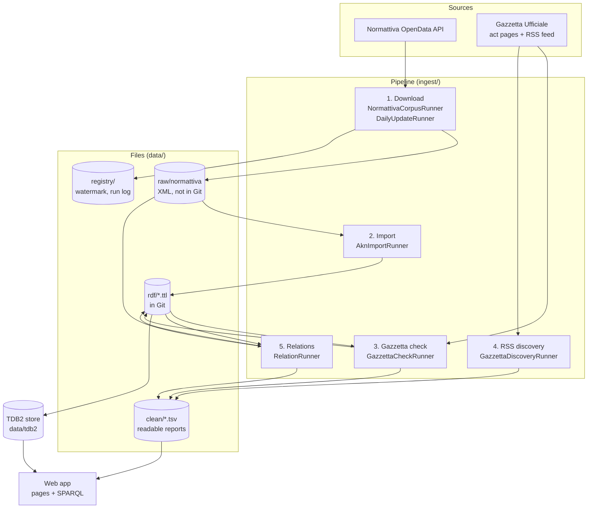
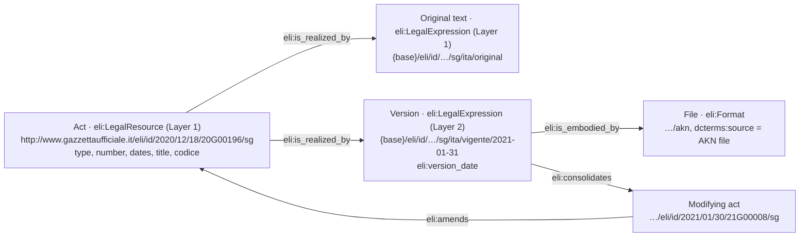
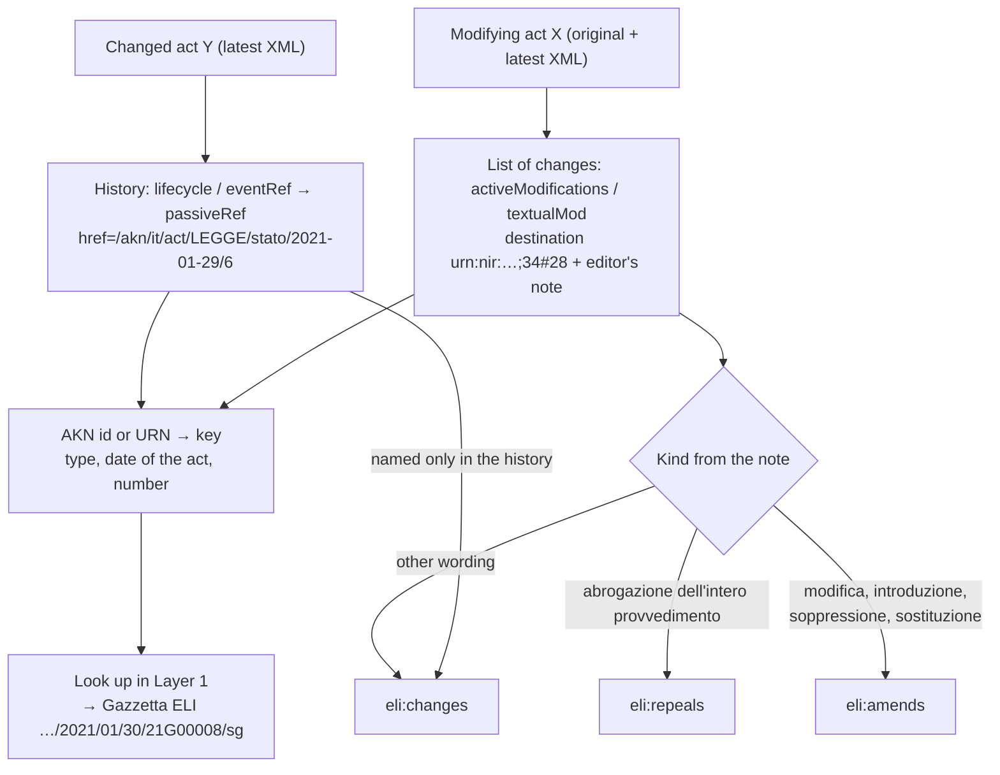

# Architecture

How the application gets Italian legislation, turns it into linked data with the European
Legislation Identifier (ELI), finds the relations between acts, keeps it up to date, and serves
it. External interfaces are described in [docs/API.md](docs/API.md).

## 1. Overview



| Layer | Package | Main classes |
|---|---|---|
| Sources | `source.normattiva`, `source.gazzetta` | `NormattivaClient`, `HttpNormattivaTransport`, `GazzettaActPage`, `GazzettaRssUpdateRunner`, `HttpPageFetcher` |
| Mapping | `mapping` | `AknActReader`, `AknToEli` |
| Relations | `relations` | `AknRelationReader`, `ModificationNote`, `ActKey`, `CorpusIndex`, `RelationDetector`, `VersionHistory` |
| Steps | `ingest` | `AknImportRunner`, `GazzettaCheckRunner`, `GazzettaDiscoveryRunner`, `RelationRunner`, `DailyUpdateRunner`, `ReferenceSetRunner`, `RecallSetRunner` |
| Store | `store` | `Tdb2DatasetService` |
| Web | `eli`, `web` | `EliResolutionController`, `ActPages`, `ActCatalog`, `AboutPage`, `SparqlPage`, `SparqlEndpointController` |

Technology: Java 17, Spring Boot 2.7, Apache Jena 4.10 (TDB2, ARQ), JUnit 5.

## 2. Data model: pure ELI, two layers

Only ELI terms are used (plus `dcterms:source` and `dcterms:identifier`); there is no custom
ontology.



| Layer | File | Contains |
|---|---|---|
| Layer 1 | `data/rdf/layer1_acts.ttl` | every act and its original text: the lookup table from type + date + number to the act's ELI |
| | `data/rdf/layer1_gazzetta.ttl` | `eli:first_date_entry_in_force` for each act its Gazzetta page confirms |
| Layer 2 | `data/rdf/layer2_versions.ttl` | every consolidated version, with its date and its file |
| Relations | `data/rdf/relations.ttl` | `eli:amends` / `eli:repeals` / `eli:changes` between acts; `eli:consolidates` from each version to the act that produced it |

**Identity.** An act is identified by its **Gazzetta Ufficiale ELI**
(`http://www.gazzettaufficiale.it/eli/id/{yyyy}/{mm}/{dd}/{codice}/sg`): the official address,
made of the GU date and the redactional code. Versions and files are not published by the
Gazzetta, so they use the application's own base (`legal.eli.base-uri`) with the same path. An act
outside the corpus that a relation points to gets `{base}/eli/ext/{type}/{date}/{number}`.

The outcome of the Gazzetta check, the evidence behind each relation and the conversion status
are not RDF: they are in the readable reports (`data/clean/*.tsv`), which the pages read.

## 3. Pipeline

### 3.1 Download (Normattiva)

`NormattivaCorpusRunner` counts the acts of each type and year, then exports them with **all
versions** as Akoma Ntoso (export mode M). Years with more than 100 acts are exported month by
month. Exports already on disk are skipped, so an interrupted run can be restarted. Every file is
recorded with its SHA-256 in `data/raw/normattiva/manifest.tsv` (in Git; the files are not).

### 3.2 Import: Layer 1 and Layer 2

`AknImportRunner` reads each XML file with a secure parser (no DTDs or external entities). The
original text (`…_ORIGINALE_V0.xml`) becomes the act and its original expression in Layer 1;
each later file (`…_VIGENZA_{date}_V{n}.xml`) becomes a version in Layer 2. The date of the
original version is the AKN expression date (`FRBRExpression/FRBRdate`), which is the entry into
force.

### 3.3 Gazzetta Ufficiale check

`GazzettaCheckRunner` opens each act's Gazzetta page (built from its GU date and codice) and
compares **type, number, date of the act and GU date** with Normattiva. The Gazzetta ELI and its
metadata carry no act number: the number is read from the page heading
("DECRETO-LEGGE 18 dicembre 2020, n. 172"). The page also gives the GU issue and the entry into
force. Pages are saved in `data/raw/gazzetta/` and fetched once, one request per second.
Output: `data/clean/gazzetta_check.tsv` (MATCH / MISMATCH / NOT_FOUND / ERROR per act) and
`layer1_gazzetta.ttl`.

### 3.4 Gazzetta RSS discovery

The RSS feed of the Gazzetta Ufficiale (Serie Generale) is harvested daily into
`data/clean/gazzetta_rss_updates.tsv`. `GazzettaDiscoveryRunner` takes from it the laws,
decree-laws and legislative decrees (a "G" codice; "A" codes are notices about an act), reads each
new act's page once, and looks the act up in Layer 1. `data/clean/gazzetta_discovery.tsv` lists
each act as `IN_NORMATTIVA` or `WAITING`: published in the Gazzetta, text not yet delivered by
Normattiva. The page details are kept in the report, so the GitHub job (which keeps no HTML) does
not fetch a page twice. The About & Help page lists the acts waiting.

### 3.5 Relations: from AKN id to ELI

`RelationRunner` reads, for every act, its original text and its latest version, and gives the
evidence to `RelationDetector`.



**AKN id → ELI.** Normattiva names a modifying act by its AKN id, which holds the type, the
date of the act and the number. The Gazzetta ELI needs the GU date and the codice instead (L.
6/2021 is dated 29 January and published on 30 January). So the id is turned into a key and
looked up in Layer 1; Layer 1 is built first for this reason.

Rules:

- The list of changes is read from the **original and the latest version**: a conversion law
  can add articles to a decree-law ("art. 2-bis") that change other acts; they are legally the
  decree's but appear only in its later versions. An entry in both is counted once.
- All changes from X to the same Y form **one relation**; the strongest kind wins
  (repeals > amends > changes).
- A note that describes a change made through a third act is not counted for the destination.
- A relation found only in Y's history becomes `eli:changes` (its kind is not recorded).
- A law or legislative decree cannot change an act published after it: such a history-only
  relation is dropped (R7). A decree-law can, through its conversion law.
- Whole repeals stated only in the text ("Il decreto-legge … è abrogato") count as
  `eli:repeals`.

Reports: `data/clean/relations.tsv` (one line per relation: where it was found, number of
changes, kinds, every editor's note) and `data/clean/version_history.tsv` (which act produced
each version, and when).

### 3.6 Conversion of decree-laws (Constitution, art. 77)

The title of each law in Layer 1 is matched against
`Conversione in legge[, con|senza modificazioni,] del decreto-legge {day} {month} {year}, n. {N}`
(handling "1°" and a "3l" typing error), and the decree is looked up in Layer 1.

| Status | Meaning |
|---|---|
| CONVERTED | a law's title converts it (or Normattiva lists a converting law whose text is not exported yet) |
| PENDING | no law yet, within 60 days of publication |
| NOT_CONVERTED | no law, more than 60 days |

Reading the history alone is not enough: decrees merged into another decree's conversion law are
repealed by it, not converted (e.g. D.L. 9/2020 by L. 27/2020). Output: `data/clean/conversions.tsv`.

## 4. Store

`Tdb2DatasetService` keeps a persistent TDB2 store, loaded from the four RDF files. Loading only
**adds** statements: after a change of the data model, delete `data/tdb2` and restart.

## 5. Web application

Server-rendered HTML, no JavaScript, in English and Italian (`?lang=it` / `?lang=en`). Every page
is built from live SPARQL queries and the reports in `data/clean/`.

- **Legal acts** (`/`): an introduction, search (a number alone, or "18/2020", finds the exact act),
  filters, and the dataset in numbers with the date of the last successful update.
- **Act details** (the act's own ELI address): facts, the Gazzetta check in words, the conversion,
  the versions newest first, and two relation tables (modifying act · relation · changed act ·
  date). A short explanation with a glossary link sits under each section.
  `Accept: text/turtle` or `?format=ttl` gives RDF.
- **About & Help** (`/about`): what the portal is, the sources, how to use it, how relations are
  found and their limits, how current and complete the data is (read from the reports), and a
  glossary.
- **SPARQL**: `/query` with eight example questions (`queries/*.rq`); `/sparql` (SPARQL 1.1
  Protocol, read-only, 30 s limit) for programs.

## 6. Keeping up to date

```mermaid
sequenceDiagram
    participant GH as GitHub Actions (daily)
    participant U as DailyUpdateRunner (own machine)
    participant N as Normattiva API
    participant G as Gazzetta Ufficiale
    GH->>G: RSS feed → gazzetta_rss_updates.tsv
    GH->>G: new act pages → gazzetta_discovery.tsv
    U->>N: acts changed since the watermark; acts listed but not imported
    loop each act
        U->>N: export all versions (fallback: original, current)
        N-->>U: ZIP (or empty: no text yet, retried next run)
    end
    U->>G: import → Gazzetta check → RSS discovery → relations
    U->>U: advance the watermark only if nothing failed
```

Normattiva blocks GitHub's servers (HTTP 409), so the Normattiva part runs on our own machine
(`scripts/daily-update`, or the in-app job with `LEGAL_DAILY_UPDATE_ENABLED=true`).

## 7. Evaluation

`ReferenceSetRunner` draws a random sample of decree-law statuses and relations
(`data/eval/reference_set.tsv`), checked by hand against Normattiva and the Gazzetta Ufficiale;
precision is given with a 95 % Wilson interval. `RecallSetRunner` measures recall on a second
sample (`data/eval/recall_set.tsv`): outgoing relations against the act's text in the Gazzetta,
incoming relations against "Aggiornamenti all'atto" on normattiva.it.

## 8. Design decisions

| Decision | Reason |
|---|---|
| Two layers: acts and originals, then versions | Layer 1 is the lookup table that turns AKN ids into ELIs; versions hang off it |
| The Gazzetta ELI as the act's identity | The official address; no invented identifier, no `owl:sameAs` |
| Pure ELI, no custom ontology | Interoperable with other ELI publishers; outcomes of checks live in reports |
| Relations from Normattiva's own records, no text mining | Every relation traces to an element of an official file |
| The Gazzetta for identity, check and discovery | It is the official source of publication, and it announces acts first |
| Additive store, raw XML outside Git with a checksum manifest | 2.6 GB of sources stays reproducible without bloating the repository |

## 9. Limitations

- Relations are as complete as Normattiva's records.
- Acts outside the corpus (before 2020, DPR, DPCM, regional laws) have placeholder ELIs.
- Changes made through a third act are not counted as direct relations.
- Some recent acts are listed by Normattiva without text; they are retried at every update.
- The ELI base URI for versions is a placeholder until deployment.
