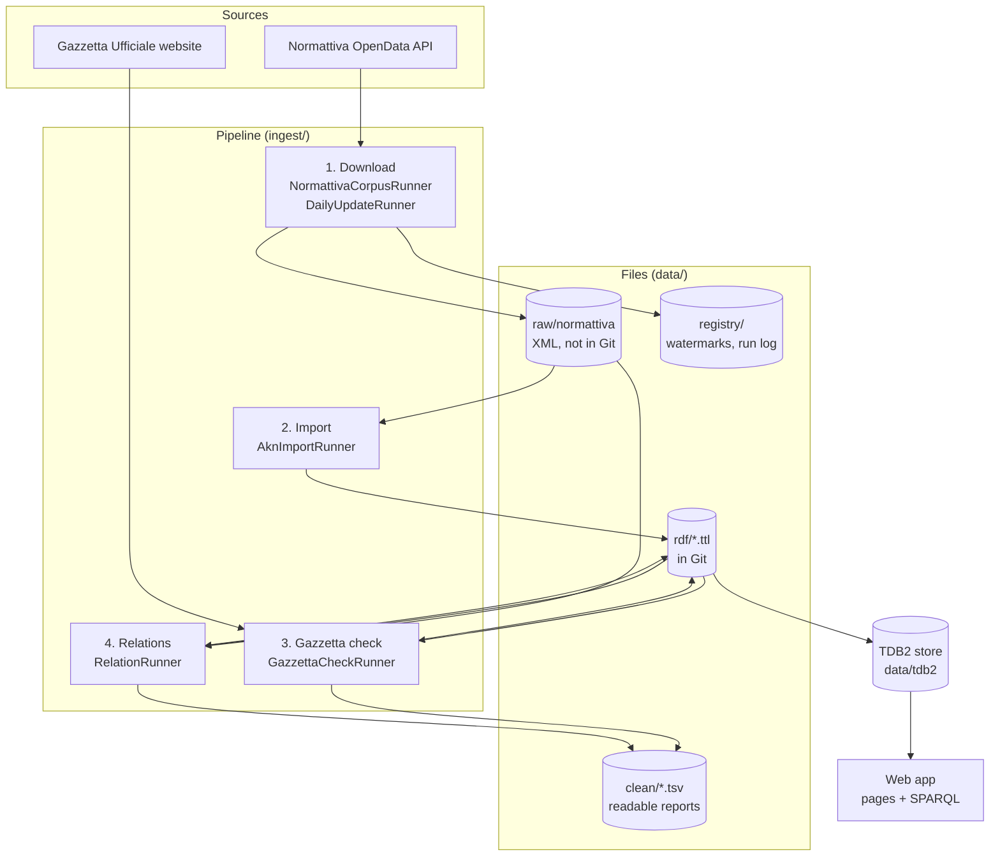
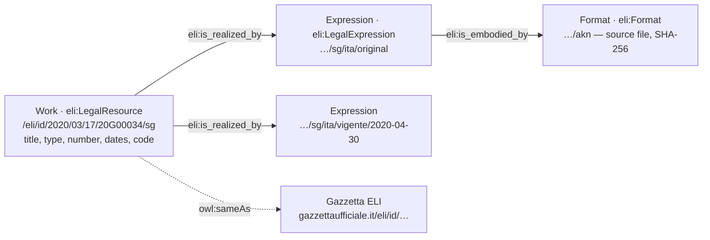
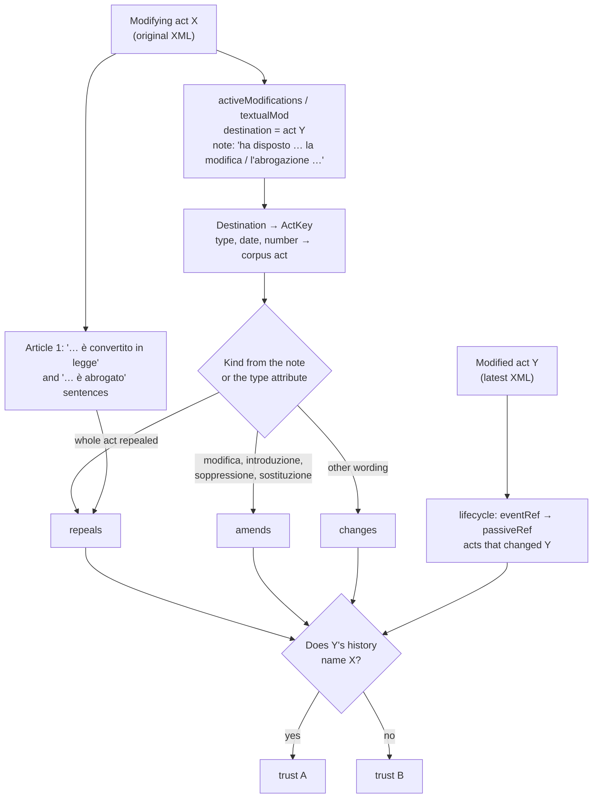
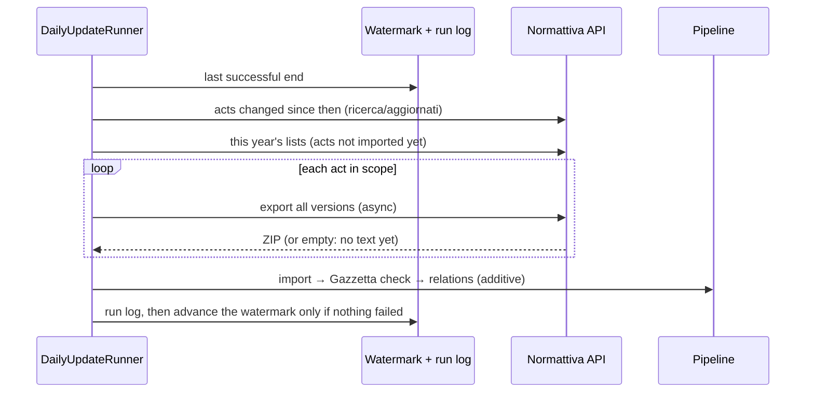

# Architecture

How the application gets Italian legislation, turns it into linked data, finds the relations
between acts, keeps it up to date, and serves it. External interfaces are described in
[docs/API.md](docs/API.md).

## 1. Overview

| Layer | Package | Main classes |
|---|---|---|
| Sources | `source.normattiva`, `source.gazzetta` | `NormattivaClient`, `HttpNormattivaTransport`, `GazzettaActPage`, `HttpPageFetcher` |
| Mapping | `mapping` | `AknActReader`, `AknToEli`, `AssessmentHistory` |
| Relations | `relations` | `AknRelationReader`, `ModificationNote`, `ActKey`, `CorpusIndex`, `RelationDetector` |
| Steps | `ingest` | `AknImportRunner`, `GazzettaCheckRunner`, `RelationRunner`, `DailyUpdateRunner`, `ReferenceSetRunner` |
| Store | `store` | `Tdb2DatasetService` |
| Web | `eli`, `web` | `EliResolutionController`, `ActPages`, `ActCatalog`, `SparqlPage`, `SparqlEndpointController` |

Technology: Java 17, Spring Boot 2.7, Apache Jena 4.10 (TDB2, ARQ), JUnit 5.

## 2. Data model

ELI's three levels, on the application's own domain (`legal.eli.base-uri`):

Relations and changing results:

| Resource | Says |
|---|---|
| `ilg:Relation` | from act, to act, `eli:amends` / `eli:repeals` / `eli:changes`, editor's note, source file |
| `law ilg:converts decree` | conversion (`ilg:converts` is declared a sub-property of `eli:changes`; ELI has no conversion property) |
| `ilg:ExternalAct` | an act outside the corpus that a relation points to (type, date, number) |
| `ilg:RelationAssessment` | trust A/B, number of textual modifications, confirmed by history, status FOUND / WITHDRAWN |
| `ilg:ConversionCheck` | status, converting law, days, checks C1–C6, trust |
| `ilg:GazzettaCheck` | MATCH / MISMATCH / NOT_FOUND / ERROR |

The `ilg:` namespace is `http://example.org/italian-legislation/ontology#`.

### Dated assessments

Facts (an act, a version, "X amends Y") are only ever added. Results that can change
(PENDING today, CONVERTED next month) are **assessment nodes** with `ilg:assesses` and
`ilg:assessedOn`. A run writes a new node only when the result differs from the latest one;
nothing is removed. Queries take the latest with `FILTER NOT EXISTS { a newer one }`, and the
whole history stays queryable (`queries/more/status-history.rq`).

## 3. Pipeline

### 3.1 Download (Normattiva)

`NormattivaCorpusRunner` counts the acts of each type and year, then exports them with **all
versions** as Akoma Ntoso. Years with more than 100 acts are exported month by month. Exports
already on disk are skipped, so an interrupted run can be restarted. Every file is recorded with
its SHA-256 in `data/raw/normattiva/manifest.tsv` (in Git; the files themselves are not).

### 3.2 Import

`AknImportRunner` reads each XML file with a secure parser (no DTDs or external entities) and
writes `data/rdf/normattiva_akn.ttl`: one Work per act, one Expression per version, one Format
per file.

### 3.3 Gazzetta Ufficiale check

`GazzettaCheckRunner` opens each act's page on Gazzetta Ufficiale and compares **type, number,
date of the act and GU date**. A different title wording is reported but is not a mismatch. It
also records the GU issue and the entry-into-force date. Pages are cached, one request per
second. Output: `gazzetta_check.ttl`, `clean/gazzetta_check.tsv`.

### 3.4 Relations

`RelationRunner` reads, for every act, its **original** text (where its own changes are listed)
and its **latest** version (where its history is complete), and gives the evidence to
`RelationDetector`.

Rules:

- All modifications from X to the same Y form **one relation**, with their count.
- A note that names a third act ("la conversione del D.L. …") describes an indirect effect and is
  not counted for the destination.
- Text is used only in three narrow patterns (conversion in Article 1, the title "Conversione in
  legge … del decreto-legge …", and "Il decreto-legge … è abrogato"). Editorial notes, quotations
  and «quoted text» are removed first, and a sentence naming an article, paragraph or letter is
  not a whole repeal.
- A relation found only in Y's history becomes `changes`, trust B.

**Trust:** A when the modifying act's change list and the modified act's history both record the
relation (two independent statements), B when only one does — mostly because the modified act is
outside the corpus.

### 3.5 Conversion of decree-laws (Constitution, art. 77)

| Check | Rule |
|---|---|
| C1 | the law is a LEGGE, the act a DECRETO-LEGGE |
| C2 | a structured link: the law's note "la conversione … del D.L. …", the decree's own note ", convertito … dalla L. …", or the law's modifications of a decree it names |
| C3 | Article 1 or the title says the decree "è convertito in legge" |
| C4 | the decree is identified uniquely in the corpus |
| C5 | published within 60 days of the decree |
| C6 | only one law passes |

| Status | Meaning |
|---|---|
| CONVERTED | C1–C6 pass, C2 and C3 both (trust A) |
| CONVERTED_ONE_SOURCE | as above with only C2 or only C3 (trust B) |
| REVIEW | a candidate law fails a check |
| PENDING | no law yet, within 60 days |
| AWAITING_LAW_TEXT | Normattiva lists the converting law but its text is not published yet |
| REPEALED | repealed before conversion (often merged into another decree's law) |
| NOT_CONVERTED | no law, not repealed, more than 60 days |

## 4. Store

`Tdb2DatasetService` keeps a persistent TDB2 store. The `.ttl` files are read into it once; a
file is read again only when it changes, and reading only **adds** statements. Reads use read
transactions and touch no files. The store survives restarts.

## 5. Web application

Server-rendered HTML, no JavaScript. Every page is built from live SPARQL queries. The interface
is in English and Italian: `?lang=it` / `?lang=en` (the switch at the top right) chooses, a cookie
remembers the choice, and otherwise the browser's language decides. Texts are in
`src/main/resources/i18n/messages_{en,it}.properties`; the data itself (titles, citations) is
Italian in both. Colours and
type follow the Italian public administration's design system (Designers Italia): Italia blue
`#0066CC` for navigation and links, Titillium Web as typeface, and green, amber and red only for
meaning (confirmed; waiting or to check; repealed or contradicted).

- **Legal acts** (`/`): search, four numbers (acts, Gazzetta check, relations, decree-laws),
  filters, and one card per act with its statuses. `/acts.csv` gives the same list as CSV.
- **Act details**: at the act's own ELI address. The answer first (citation, title, statuses,
  ELI address), then facts, conversion (the six checks behind "How was this verified?"), the
  Gazzetta check, the versions as a timeline, and the relations with trust A/B and evidence.
  Browsers get HTML; `Accept: text/turtle` or `?format=ttl` gets RDF (content negotiation).
  Versions and formats get a generic resource page.
- **SPARQL**: `/query` for people: eight example questions (`queries/*.rq`) and readable results
  (acts as citations, document types by name). `/sparql` (SPARQL 1.1 Protocol, read-only, 30 s
  limit) for programs.

## 6. Keeping up to date

- A failed or partial run leaves the watermark where it was, so the next run asks for the same
  period again: no gaps.
- It needs the raw corpus and a network Normattiva accepts. Normattiva blocks GitHub's servers
  (HTTP 409), so the update runs on a machine of ours: by hand (`scripts/daily-update`) or as the
  in-app job `ScheduledDailyUpdateJob` (`LEGAL_DAILY_UPDATE_ENABLED=true`).
- The GitHub workflow `scheduled-ingestion.yml` harvests the Gazzetta Ufficiale RSS feed daily
  (see [docs/API.md](docs/API.md)); it does not call Normattiva.

## 7. Evaluation

`ReferenceSetRunner` draws a stratified random sample of decree-law statuses and relations
(`data/eval/reference_set.tsv`). Each row is checked by hand against Normattiva and Gazzetta
Ufficiale, then precision is computed with a 95 % Wilson interval. Result: 54 / 54 correct
(≥ 93.4 % overall).

## 8. Design decisions

| Decision | Reason |
|---|---|
| ELI on our own domain, `owl:sameAs` to Gazzetta | Dereferenceable, stable identifiers we can serve |
| Read Normattiva's structured data, text only in narrow patterns, no AI | Every relation can be traced to an element of an official file |
| Two-source trust levels | Separates confirmed relations from single-statement ones |
| Additive ingestion with dated assessments | Nothing is lost; the history of every status is kept |
| Server-rendered pages | One address per act for people and programs; no build step |
| Raw XML outside Git, manifest with checksums inside | 2.6 GB of sources stays reproducible without bloating the repository |

## 9. Limitations

- Relations to acts outside the corpus (before 2020, other types) can only be trust B.
- Text patterns cover the standard wording; unusual wording is left as `changes` or not detected.
- The ELI base URI is a placeholder until deployment.
