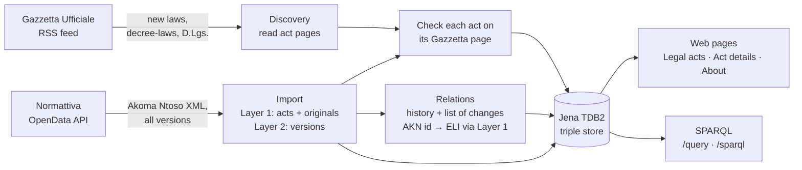

# Italian Legislation Linked Data

Master's thesis project. It turns Italian national legislation into **linked open data** with the
European Legislation Identifier ([ELI](https://op.europa.eu/en/web/eu-vocabularies/eli)): every act,
all its versions, which acts amend, repeal or convert others, and a public SPARQL endpoint.

**Corpus:** every *Legge*, *Decreto-legge* and *Decreto legislativo* from 2020 to today.

| | |
|---|---|
| Acts | 1,115 |
| Versions (original and consolidated texts) | 4,153 |
| Acts confirmed against Gazzetta Ufficiale | 1,113 (2 pages not read yet, retried by the next check) |
| Relations between acts | 7,763 (amends 6,040 · changes 1,510 · repeals 213) |
| Decree-laws | 249 (191 converted) |

*Figures of 28 October 2026, before the change list was read from the latest version too
(more relations become amends); they change with each daily update.*

## How it works



- **Normattiva** gives the content: each act's original text and every later version
  (Akoma Ntoso), its history (which acts changed it) and its list of changes to other acts.
- **Gazzetta Ufficiale** gives the identity and the check: each act is identified by its
  Gazzetta ELI (`http://www.gazzettaufficiale.it/eli/id/2020/03/17/20G00034/sg`); its page confirms
  type, number (read from the heading: the Gazzetta ELI has none), dates and entry into force.
  Its daily RSS feed announces new acts before Normattiva has them.
- **Pure ELI**: only ELI terms (plus `dcterms:source`); no custom ontology. Acts are
  `eli:LegalResource` (Layer 1), versions `eli:LegalExpression` with `eli:version_date`, each
  linked to the act that produced it with `eli:consolidates` (Layer 2); relations are
  `eli:amends`, `eli:repeals`, `eli:changes`.

Details: [ARCHITECTURE.md](ARCHITECTURE.md). External sources and the app's own endpoints:
[docs/API.md](docs/API.md).

## Quick start

Requirements: **Java 17** and **Maven 3.9+**.

```bash
cd jena-git-project
mvn -B test            # build and run the tests
mvn spring-boot:run    # start the app
```

Open <http://localhost:8080>. The first start reads `data/rdf/*.ttl` into the store
(`data/tdb2`), which takes a few minutes; later starts are fast.

| View | Address |
|---|---|
| Legal acts (search, filters) | `/` |
| Act details (versions, Gazzetta check, conversion, relations) | `/eli/id/{yyyy}/{mm}/{dd}/{code}/sg`, e.g. `/eli/id/2020/03/17/20G00034/sg` |
| About & Help (sources, method, coverage, glossary) | `/about` |
| SPARQL form and example queries | `/query` |
| SPARQL 1.1 endpoint for programs | `/sparql` |
| Health | `/api/health` |

Each act page is also RDF: `curl -H "Accept: text/turtle" http://localhost:8080/eli/id/2020/03/17/20G00034/sg`.

## Keeping the data up to date

The committed RDF files are enough to run the app. To fetch new and changed acts:

```bash
scripts/daily-update.sh --dry-run true   # what changed, nothing downloaded
scripts/daily-update.sh                  # download, import, Gazzetta check and RSS discovery, relations
```

On Windows use the `.cmd` scripts (`scripts\daily-update.cmd`). The update needs the raw
Normattiva corpus on disk (`scripts/build-corpus.sh` builds it once; 2.6 GB, not in Git) and a
network Normattiva accepts: it blocks GitHub's servers, so it runs on your own machine or server.

All helper scripts are in [`scripts/`](scripts):

| Script | Does |
|---|---|
| `run-app` | Start the web app |
| `build-corpus` | First full download and processing (hours) |
| `daily-update` | Fetch changed and missing acts, re-run the pipeline |
| `evaluate` | Checks by hand: precision (`sample`, then `evaluate`) and recall (`recall-sample`, then `recall`) |
| `validate-akn` | Check Akoma Ntoso files before import |

## Repository layout

```text
README.md, ARCHITECTURE.md, CONTRIBUTING.md, LICENSE
docs/API.md                 External APIs (Normattiva, Gazzetta) and the app's endpoints
scripts/                    Helper scripts (.sh for Linux/Git Bash, .cmd for Windows)
.github/workflows/          CI (tests on pull requests) and the daily Gazzetta RSS harvest and discovery
render.yaml                 Deployment definition (Render)
jena-git-project/           The application (Java 17, Spring Boot, Apache Jena)
  src/main/java/it/legislation/
    source/                 Clients for Normattiva and Gazzetta Ufficiale (act pages, RSS feed)
    mapping/                Akoma Ntoso → ELI RDF (Layer 1 and Layer 2)
    relations/              Relation and conversion detection
    ingest/                 Runnable steps (import, Gazzetta check, RSS discovery, relations,
                            daily update, evaluation)
    store/                  TDB2 triple store
    eli/, web/              ELI addresses, pages, SPARQL
  data/                     Outputs in Git: RDF, readable TSV reports, registry, evaluation
  queries/                  The example questions on /query; more/ holds further queries
```

## Data sources and licence

- Legislation: [Normattiva](https://www.normattiva.it) OpenData (Istituto Poligrafico e Zecca dello
  Stato), used under its terms of use. Publication data: [Gazzetta Ufficiale](https://www.gazzettaufficiale.it).
- Code: [MIT licence](LICENSE).
