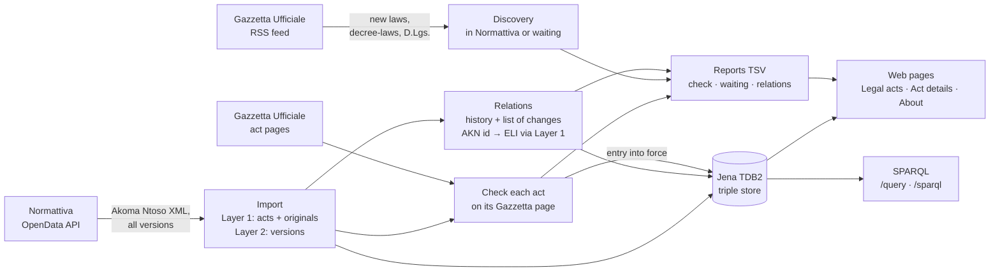

# Italian Legislative Knowledge Graph

**Building an Italian Legislative Knowledge Graph: Integrating Gazzetta Ufficiale and Normattiva through the ELI Ontology**

This project turns Italian national legislation into linked open data. It takes every law,
decree-law and legislative decree published since 2020, identifies each one by its official
Gazzetta Ufficiale address, attaches every version of its text from Normattiva, and works out
which acts amend, repeal or convert which others. Everything is published with the European
Legislation Identifier (ELI), so you can browse it on web pages or query it with SPARQL.

## Table of contents

- [How it works](#how-it-works)
- [Prerequisites](#prerequisites)
- [Installation and setup](#installation-and-setup)
- [Usage and examples](#usage-and-examples)
- [Keeping the data up to date](#keeping-the-data-up-to-date)
- [Testing](#testing)
- [Configuration](#configuration)
- [Repository structure](#repository-structure)
- [Contributing](#contributing)
- [Data sources and licence](#data-sources-and-licence)

## How it works

The project combines two official sources, each doing what it does best:

- **Gazzetta Ufficiale** is where acts are legally published. It gives each act its identity
  (its ELI, e.g. `http://www.gazzettaufficiale.it/eli/id/2020/12/18/20G00196/sg`) and the details
  we check against: type, number, dates and entry into force. Its daily RSS feed also tells us
  about new acts.
- **Normattiva** holds the life of each act over time: the original text and every later version
  in Akoma Ntoso XML, plus records of which acts changed it.

From these, the pipeline builds a knowledge graph in two layers:

1. **Layer 1, the acts:** one entry per act with its original text. This layer also works as a
   lookup table, turning "law of 29 January 2021, n. 6" into that act's ELI.
2. **Layer 2, the versions:** every consolidated text, with the date it came into force and its file.

On top of these sit the **relations**: amends, repeals, and the conversion of decree-laws into law
(`eli:commences`); each version is linked to the one before it (`eli:consolidates`). They're all written using only the ELI vocabulary.



If you want the full picture, [ARCHITECTURE.md](ARCHITECTURE.md) explains every step, and
[docs/API.md](docs/API.md) describes the external APIs and the app's own endpoints.

## Prerequisites

You'll need:

| Tool | Version | Why |
|---|---|---|
| **Java** | 17 | Runs the application |
| **Maven** | 3.9 or newer | Builds it and runs the tests |
| **Git** | any recent | To clone the repository |

You'll also need about 1 GB of free disk space for the app and its database. If you want to
rebuild the corpus from Normattiva yourself, allow another 3 GB.

Windows works fine: use Git Bash for the `.sh` scripts, or the `.cmd` versions in `scripts/`.

## Installation and setup

```bash
git clone https://github.com/arvind088/italian-legislative-knowledge-graph.git
cd italian-legislative-knowledge-graph/jena-git-project
mvn -B test              # builds the project and runs the tests
mvn spring-boot:run      # starts the app
```

Then open <http://localhost:8080>.

The data you need is already in the repository (`data/rdf/*.ttl`), so you don't have to download
anything to get started. The first start loads it into the local database (`data/tdb2`), which
takes a few minutes; after that, starts are quick.

The `Dockerfile` in `jena-git-project` builds and runs the same app; it is what the Render
deployment (`render.yaml`) uses.

## Usage and examples

### In the browser

| Page | Address | What you'll find |
|---|---|---|
| Legal acts | `/` | Search by title, number (`18/2020`) or code (`20G00034`), with filters by type, year and conversion status |
| Act details | `/eli/id/2020/12/18/20G00196/sg` | Facts, the Gazzetta check, the conversion, every version, and who changed whom |
| About & Help | `/about` | Where the data comes from, how it's built, how current it is, and a glossary |
| SPARQL | `/query` | Eight ready-made questions, or write your own |

### As data

Every act page is also RDF. Just ask for Turtle:

```bash
curl -H "Accept: text/turtle" http://localhost:8080/eli/id/2020/12/18/20G00196/sg
```

### With SPARQL

For example, every version of D.L. 172/2020 and its date:

```sparql
PREFIX eli: <http://data.europa.eu/eli/ontology#>
SELECT ?version ?date WHERE {
  <http://www.gazzettaufficiale.it/eli/id/2020/12/18/20G00196/sg> eli:is_realized_by ?version .
  ?version eli:version_date ?date .
} ORDER BY ?date
```

From a program, send it to the SPARQL endpoint:

```bash
curl -H "Accept: application/sparql-results+json" \
  --data-urlencode "query=SELECT (COUNT(*) AS ?n) WHERE { ?s ?p ?o }" \
  http://localhost:8080/sparql
```

## Keeping the data up to date

New acts are published almost every day. To bring the data up to date:

```bash
scripts/daily-update.sh --dry-run true   # shows what changed, downloads nothing
scripts/daily-update.sh                  # downloads, imports, checks and finds relations
```

A few things are worth knowing:

- The update asks Normattiva for everything published or changed since the last successful run,
  so nothing is missed if a day is skipped.
- Normattiva blocks requests from cloud servers such as GitHub's, so the Normattiva part runs on
  your own machine.
- The Gazzetta RSS feed is read every morning by GitHub Actions
  (`.github/workflows/scheduled-ingestion.yml`).
- The first full download of the corpus is `scripts/build-corpus.sh`. It takes a few hours and
  about 3 GB.

You can also run each step on its own, which is useful after changing code:

```bash
cd jena-git-project
mvn -q exec:java -Dexec.mainClass=it.legislation.ingest.AknImportRunner          # Layer 1 + Layer 2
mvn -q exec:java -Dexec.mainClass=it.legislation.ingest.GazzettaCheckRunner      # check against the Gazzetta
mvn -q exec:java -Dexec.mainClass=it.legislation.ingest.GazzettaDiscoveryRunner  # RSS: what's waiting
mvn -q exec:java -Dexec.mainClass=it.legislation.ingest.RelationRunner           # relations + conversions
```

Loading data into the database only ever adds to it. If you change how the data is modelled,
delete `data/tdb2` and restart, so the database is rebuilt from the files.

## Testing

```bash
cd jena-git-project
mvn -B test
```

The tests use small extracts of **real** Normattiva and Gazzetta files (in `src/test/resources/`).
They don't touch the network, so they run anywhere.

Every pull request runs the same tests automatically (`.github/workflows/ci.yml`).

To measure the quality of the relations by hand, `scripts/evaluate.sh` draws a random sample for
precision, and `scripts/evaluate.sh recall` does the same for recall.

## Configuration

Settings live in `jena-git-project/src/main/resources/application.properties`. You can override
any of them with an environment variable. There's no `.env` file, and the defaults work out of
the box.

| Variable | Default | What it does |
|---|---|---|
| `LEGAL_ELI_BASE_URI` | `https://osservatorio-eli.example.it` | The address versions and files are published under. Set it to your real domain when deploying |
| `LEGAL_TDB2_PATH` | `data/tdb2` | Where the database lives |
| `LEGAL_SPARQL_TIMEOUT_SECONDS` | `30` | How long one SPARQL query may run |
| `LEGAL_DAILY_UPDATE_ENABLED` | `false` | Turn on the built-in daily update (needs the raw corpus and a network Normattiva accepts) |
| `PORT` | `8080` | Web port when running in Docker |
| `GAZZETTA_RSS_URL`, `GAZZETTA_RSS_MAX_ENTRIES` | Serie Generale feed, `50` | Settings for the RSS harvest |

## Repository structure

```text
.
├── README.md                     You are here
├── ARCHITECTURE.md               How the pipeline, data model and web app fit together
├── CONTRIBUTING.md               How to work on the project
├── LICENSE                       MIT
├── docs/API.md                   Normattiva and Gazzetta APIs, and the app's own endpoints
├── scripts/                      Helpers (.sh for Linux/Git Bash, .cmd for Windows):
│                                 run-app, build-corpus, daily-update, evaluate, validate-akn
├── .github/workflows/            Tests on every pull request; daily Gazzetta RSS harvest
├── render.yaml                   Deployment definition (Render)
└── jena-git-project/             The application (Java 17, Spring Boot, Apache Jena)
    ├── pom.xml
    ├── Dockerfile
    ├── src/main/java/it/legislation/
    │   ├── source/               Talking to Normattiva and the Gazzetta (API client, act pages, RSS)
    │   ├── mapping/              Akoma Ntoso XML → ELI RDF (Layer 1 and Layer 2)
    │   ├── relations/            Finding amends, repeals and conversions
    │   ├── ingest/               The pipeline steps you can run (import, check, discovery,
    │   │                         relations, daily update, evaluation)
    │   ├── store/                The Jena TDB2 triple store
    │   ├── eli/                  ELI addresses and content negotiation (HTML or RDF)
    │   └── web/                  The pages: Legal acts, Act details, About & Help, SPARQL
    ├── src/main/resources/i18n/  Interface texts in English and Italian
    ├── src/test/                 Tests, with real sample files
    ├── queries/                  The example SPARQL questions shown on /query
    └── data/
        ├── rdf/                  The knowledge graph: layer1_acts, layer1_gazzetta,
        │                         layer2_versions, relations (.ttl)
        ├── clean/                Readable reports: Gazzetta check, discovery, relations,
        │                         conversions, version history (.tsv)
        ├── registry/             When the last update ran and what it did
        ├── eval/                 Hand-checked samples for precision and recall
        └── raw/                  Downloads (only the checksum list is in Git)
```

## Contributing

Contributions and questions are welcome.

- **Found a problem or have an idea?** Open an issue and describe what you expected and what
  happened. An example act (its code, e.g. `20G00196`) helps a lot.
- **Want to change something?**
  1. Branch from `develop`: `git checkout develop && git pull && git checkout -b feature/your-change`.
  2. Make your change, together with a test (use a trimmed real file if it touches Normattiva or
     Gazzetta data).
  3. Run `mvn -B test` in `jena-git-project`.
  4. Push your branch and open a pull request into `develop`.

Any text the web pages show goes in both `messages_en.properties` and `messages_it.properties`.
More details are in [CONTRIBUTING.md](CONTRIBUTING.md).

## Data sources and licence

- **Legislation:** [Normattiva](https://www.normattiva.it) OpenData (Istituto Poligrafico e Zecca
  dello Stato), used under its terms of use. Publication data comes from the
  [Gazzetta Ufficiale](https://www.gazzettaufficiale.it).
- **This is a research prototype, not an official source.** For the legally valid text of an act,
  always refer to the Gazzetta Ufficiale.
- **Code:** released under the [MIT licence](LICENSE).
