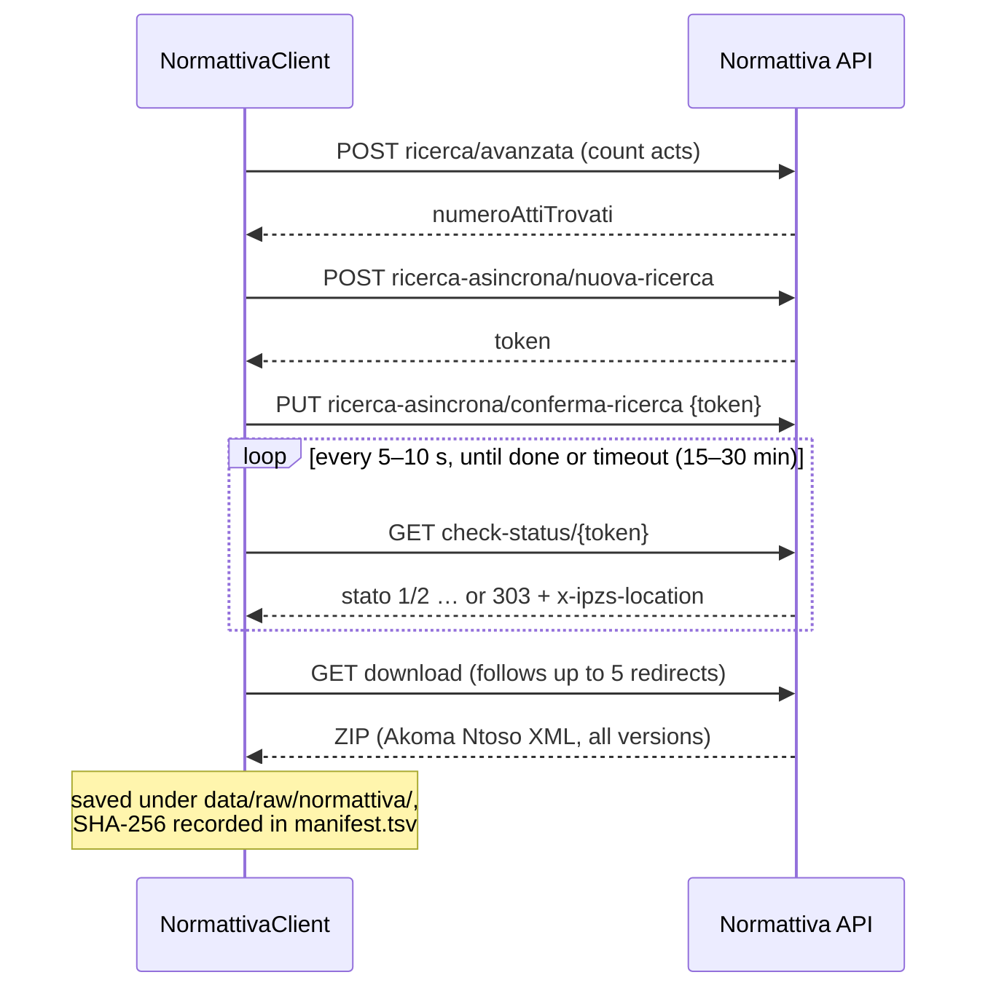
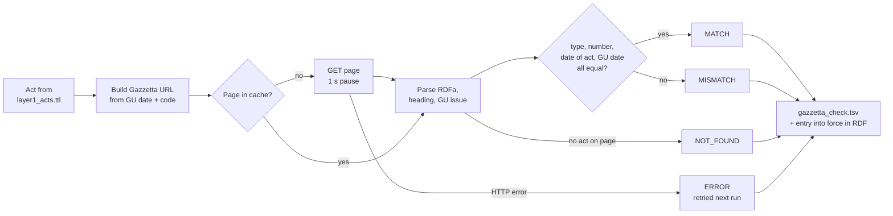
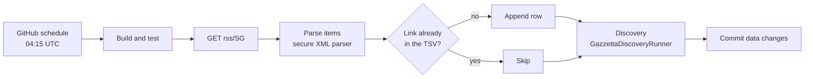

# APIs

1. [Normattiva OpenData API](#1-normattiva-opendata-api): where the acts come from
2. [Gazzetta Ufficiale](#2-gazzetta-ufficiale): act pages (check), the RSS feed (harvest) and discovery
3. [The application's own endpoints](#3-the-applications-endpoints): pages, RDF, SPARQL

---

## 1. Normattiva OpenData API

Official API of Normattiva (Istituto Poligrafico e Zecca dello Stato). JSON over HTTPS, no key.

| | |
|---|---|
| Base URL | `https://api.normattiva.it/t/normattiva.api/bff-opendata/v1/api/v1` |
| Client | `source/normattiva/NormattivaClient`, `HttpNormattivaTransport` |
| Headers sent | `User-Agent: ItalianLegislationLinkedData/0.1 (thesis project; +repository URL)`, `Content-Type: application/json` |
| Politeness | at least 0.5 s between calls; 2 retries after 2 s and 4 s; 60 s per request |

### Endpoints used

| Method | Path | Used for | Request body (main fields) | Response (fields read) |
|---|---|---|---|---|
| POST | `ricerca/aggiornati` | Acts changed in a period (daily update) | `dataInizioAggiornamento`, `dataFineAggiornamento` (ISO date-time) | `listaAtti[]`: `codiceRedazionale`, `denominazioneAtto`, `numeroProvvedimento`, `annoProvvedimento`/`meseProvvedimento`/`giornoProvvedimento` or `dataEmanazione`, `dataGU` |
| POST | `ricerca/avanzata` | Count and list acts of a type and year | `denominazioneAtto`, `annoProvvedimento`, optional `meseProvvedimento`, `giornoProvvedimento`; `paginazione` {`paginaCorrente`, `numeroElementiPerPagina`} | `numeroAttiTrovati`, `listaAtti[]` |
| POST | `atto/dettaglio-atto-urn` | Details of one act (tests, samples) | `urn` (e.g. `urn:nir:stato:decreto.legge:2020-03-17;18`) | act metadata |
| POST | `ricerca-asincrona/nuova-ricerca` | Start an export | see below | a token |
| PUT | `ricerca-asincrona/conferma-ricerca` | Confirm the export | `token` | — |
| GET | `ricerca-asincrona/check-status/{token}` | Poll the export | — | `stato` (0–6), `descrizioneStato`; when ready HTTP 303 with header `x-ipzs-location` |
| GET | `collections/download/collection-asincrona/{token}` (or the location given) | Download the ZIP | — | ZIP of Akoma Ntoso XML files |

Export request (`ExportRequest`):

```json
{
  "formato": "AKN",
  "tipoRicerca": "A",
  "richiestaExport": "M",
  "modalita": "C",
  "parametriRicerca": {
    "denominazioneAtto": "DECRETO-LEGGE",
    "annoProvvedimento": 2020,
    "meseProvvedimento": 3,
    "limitaAnniVigenza": false
  }
}
```

`richiestaExport`: `O` original text only, `V` text in force, **`M` all versions** (used here).
For one act, `giornoProvvedimento` and `numeroProvvedimento` are added.

Export states (`stato`): 0 to confirm · 1 queued · 2 processing · **3 completed** · 4 failed ·
5 service overloaded · 6 confirmed with delay.

### Export flow



### How the project calls it

| Step | Calls |
|---|---|
| First corpus (`NormattivaCorpusRunner`) | for each type × year 2020–today: count → export the year, or month by month when > 100 acts; skips exports already on disk |
| Daily update (`DailyUpdateRunner`) | `ricerca/aggiornati` for the period since the watermark; `ricerca/avanzata` lists of the current year (acts not imported yet); one export per act |

Files on disk: `data/raw/normattiva/corpus/{TYPE}/{YEAR}/…zip` and unzipped XML,
`corpus/lists/*.json` (the act lists), `updates/{day}/…` (daily update),
`manifest.tsv` (every download with checksum; the only part in Git).

### Things to know

- **Blocked from data centres.** Normattiva answers GitHub's servers with HTTP 409 ("La pagina
  richiesta è stata bloccata dai sistemi di protezione…"). Run downloads from a normal network.
- **Acts without text yet.** Recently published acts can be listed but their export is empty;
  the daily update retries them on the next run.
- **Slow exports.** A large export can take over 15 minutes; on timeout the watermark is not
  advanced, so nothing is missed.
- **Certificates.** Antivirus HTTPS scanning can break the TLS check of tools with their own
  certificate list (e.g. Git Bash `curl`: "self signed certificate in certificate chain"). The
  Windows `curl.exe` uses the Windows store; Java uses its own list, so if the app fails with
  "PKIX path building failed", turn off HTTPS scanning for `api.normattiva.it`.

Quick test:

```bash
curl -s -X POST "https://api.normattiva.it/t/normattiva.api/bff-opendata/v1/api/v1/ricerca/aggiornati" \
  -H "Content-Type: application/json" \
  -d '{"dataInizioAggiornamento":"2026-10-05T00:00:00Z","dataFineAggiornamento":"2026-10-12T00:00:00Z"}'
```

---

## 2. Gazzetta Ufficiale

Gazzetta Ufficiale publishes HTML pages, not a JSON API. The project reads two kinds of page.

### 2.1 Act pages: the Gazzetta check

| | |
|---|---|
| URL | `https://www.gazzettaufficiale.it/eli/id/{yyyy}/{mm}/{dd}/{codice}/sg` (GU date and redactional code) |
| Code | `ingest/GazzettaCheckRunner`, `source/gazzetta/GazzettaActPage`, `HttpPageFetcher` |
| Politeness | 1 request per second, 2 retries; pages cached in `data/raw/gazzetta/` (not in Git) |
| Output | `data/clean/gazzetta_check.tsv` (outcome per act), `data/rdf/layer1_gazzetta.ttl` (`eli:first_date_entry_in_force` of confirmed acts) |

What is read from the page:

| Field | Where on the page |
|---|---|
| Redactional code, type, date of the act, GU date, title | ELI RDFa attributes `property="eli:id_local"`, `eli:type_document`, `eli:date_document`, `eli:date_publication`, `eli:title` |
| Number | the heading, `… n. 18` (a `(Raccolta YYYY)` suffix is ignored). The Gazzetta ELI and its metadata have no number |
| GU issue | `Serie Generale n. 70` and the link to the issue |
| Entry into force | `Entrata in vigore del provvedimento: 17/03/2020` |



Run: `mvn -B -q compile exec:java "-Dexec.mainClass=it.legislation.ingest.GazzettaCheckRunner"`
(options: `--offline` uses the cache only, `--limit N`, `--pause-ms 1000`).

### 2.2 RSS feed: the daily harvest

| | |
|---|---|
| URL | `https://www.gazzettaufficiale.it/rss/SG` (Serie Generale) |
| Code | `source/gazzetta/GazzettaRssUpdateRunner` |
| Reads | each `<item>`: `title`, `link`, `pubDate`, `description` |
| Output | new entries appended to `data/clean/gazzetta_rss_updates.tsv` (a link already present is skipped) |
| Settings | environment variables `GAZZETTA_RSS_URL`, `GAZZETTA_RSS_OUTPUT`, `GAZZETTA_RSS_MAX_ENTRIES` (default 50) |
| Schedule | GitHub workflow `.github/workflows/scheduled-ingestion.yml`, daily at 04:15 UTC; commits the result |



Unlike Normattiva, the Gazzetta does not block GitHub's servers, so the harvest runs in GitHub
Actions. The acts' texts still come from Normattiva.

### 2.3 Discovery: the RSS feed drives the crawler

| | |
|---|---|
| Code | `ingest/GazzettaDiscoveryRunner` |
| Input | `data/clean/gazzetta_rss_updates.tsv`, Layer 1 (`data/rdf/layer1_acts.ttl`) |
| Selects | entries titled `LEGGE …`, `DECRETO-LEGGE …`, `DECRETO LEGISLATIVO …` with a "G" codice (e.g. `26G00211`); "A" codes are notices about an act |
| Reads | each new act's page, once (saved in `data/raw/gazzetta/`, as the check does) |
| Output | `data/clean/gazzetta_discovery.tsv`: codice, GU date, type, number, date of the act, status `IN_NORMATTIVA` / `WAITING`, GU issue, entry into force, page URL |
| Runs | in the GitHub workflow after the RSS harvest, and in the daily update after the Gazzetta check |

`WAITING` = published in the Gazzetta, not yet delivered by Normattiva. The About & Help page
lists them. Run: `mvn -B -q exec:java "-Dexec.mainClass=it.legislation.ingest.GazzettaDiscoveryRunner"`
(`--offline` reads saved pages only).

---

## 3. The application's endpoints

Base: `http://localhost:8080` locally, the ELI base URI once deployed.

| Method | Path | Returns |
|---|---|---|
| GET | `/` | Legal acts list. Query parameters: `q` (search; a number alone or `18/2020` finds the exact act), `type` (`LEGGE`, `DECRETO-LEGGE`, `DECRETO_LEGISLATIVO`), `year`, `status` (conversion status), `page` |
| GET | `/eli/id/{yyyy}/{mm}/{dd}/{code}/sg` | Act details page (HTML) |
| GET | same, with `Accept: text/turtle` or `?format=ttl` | The act as RDF (Turtle) |
| GET | `/eli/id/…/sg/ita/original`, `…/vigente/{date}`, `…/akn` | Version and format pages, HTML or Turtle |
| GET | any page, `?lang=it` or `?lang=en` | The same page in Italian or English; the choice is kept in the `lang` cookie |
| GET | `/acts.csv` | The Legal acts list as CSV, with the same `q`, `type`, `year`, `status` parameters |
| GET | `/about` | About & Help: sources, method, coverage (last update, acts waiting, acts not confirmed) and glossary |
| GET | `/query` | SPARQL page; `?query=…` runs a query, `?example=05-converts` runs one of the example questions in `queries/` |
| GET / POST | `/sparql` | SPARQL 1.1 Protocol: `?query=` (GET), form field `query` or body `application/sparql-query` (POST). SELECT/ASK: JSON, XML or CSV; CONSTRUCT/DESCRIBE: Turtle, RDF/XML, N-Triples or JSON-LD. Chosen by `Accept` or `?output=json|xml|csv|turtle|rdfxml|ntriples|jsonld`. Read-only, 30 s limit. A browser opening `/sparql` is sent to `/query` |
| GET | `/api/health` | JSON: store size, loaded files, daily-update status |

Examples:

```bash
curl -H "Accept: text/turtle" http://localhost:8080/eli/id/2020/03/17/20G00034/sg

curl -H "Accept: application/sparql-results+json" \
  --data-urlencode "query=SELECT (COUNT(*) AS ?n) WHERE { ?s ?p ?o }" \
  http://localhost:8080/sparql
```
